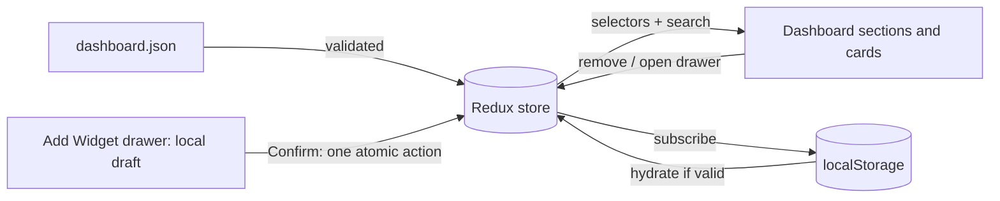

# CNAPP Dashboard

A dashboard page built for the **AccuKnox Front-End Trainee assignment**. Categories and widgets are generated from a JSON file; users can add, remove and search widgets, and the layout is saved in the browser.

Every default widget is populated with clearly labeled sample data; the dashboard does not connect to live cloud or security services.

**Live demo:** Not deployed yet — follow the [deployment steps](#deploy) below.  ·  **Stack:** React 18 · TypeScript · Redux Toolkit · Vite · Vitest

## Assignment checklist

| # | Requirement | Where it is |
|---|-------------|-------------|
| 1 | JSON that builds the dashboard; categories contain multiple widgets | [`src/data/dashboard.json`](src/data/dashboard.json), validated by [`src/data/schema.ts`](src/data/schema.ts) |
| 2 | Add and remove widgets in a category | Redux slice [`dashboardSlice.ts`](src/store/dashboardSlice.ts) (`addWidget`, `removeWidget`, `commitSelection`) |
| 3 | Widgets can show random text | Every library widget has `text`; `"type": "text"` widgets render it. Charts are an extra |
| 4 | **+ Add Widget**: enter name and text, widget is added to that category | [`AddWidgetDrawer`](src/components/drawer/AddWidgetDrawer.tsx) + [`CreateWidgetForm`](src/components/drawer/CreateWidgetForm.tsx) (validated) |
| 5 | Cross icon on each widget, or untick it in the drawer | [`WidgetCard`](src/components/dashboard/WidgetCard.tsx), [`WidgetChecklist`](src/components/drawer/WidgetChecklist.tsx) |
| 6 | Search a list of all widgets | Search box in the drawer (across **all** categories) and in the top bar (filters the dashboard) |
| – | React or Angular, any store, local run steps, GitHub, deployed site | React + Redux Toolkit; see [Run locally](#run-locally) and [Deploy](#deploy) |

## Run locally

Requires **Node.js 18 or newer** (20 recommended; `.nvmrc` is included).

```bash
npm install        # install dependencies
npm run dev        # start the dev server  ->  http://localhost:5173
```

Other commands:

```bash
npm test           # 32 unit and UI tests (Vitest + Testing Library)
npm run lint       # ESLint
npm run typecheck  # TypeScript, strict mode
npm run build      # type-check + production build into dist/
npm run preview    # serve the production build locally
```

## How to use it

- **Remove a widget:** hover a card and click the **×**. A toast offers **Undo**.
- **Add widgets:** click **Add Widget +** in the header, or the dashed **+ Add Widget** card inside a category (the drawer opens on that category). Tick or untick widgets, then press **Confirm**. **Cancel** or **Esc** discards your changes.
- **Create a widget:** in the drawer, type a *Widget name* and *Widget text*, press **Add to …**, then **Confirm**. It is appended to that category. Custom widgets can be deleted permanently (trash icon).
- **Search:** the top bar filters the dashboard. Press **/** to focus it. The drawer's search looks through every widget in every category.
- **Menu (⋮):** export the layout as JSON, import a JSON layout (validated), or reset to defaults.
- Your layout and time range persist in `localStorage`.

## How it works



**The JSON** is the single source of truth:

```jsonc
{
  "version": 1,
  "title": "CNAPP Dashboard",
  "categories": [
    {
      "id": "cspm",
      "title": "CSPM Executive Dashboard",   // section heading
      "tabLabel": "CSPM",                    // tab in the Add Widget drawer
      "widgets": [
        {
          "id": "cspm-cloud-accounts",
          "name": "Cloud Accounts",
          "type": "donut",                   // donut | stackedBar | empty | text
          "visible": true,                   // false = in the library, not on the dashboard
          "text": "Description / random text",
          "segments": [{ "label": "Connected", "value": 2, "color": "#4F6FF0" }]
        }
      ]
    }
  ]
}
```

- `visible: true` widgets appear on the dashboard; `visible: false` widgets are the library the drawer offers. **Removing** a widget sets `visible: false` (so it can be re-added or undone); only user-created widgets can be deleted for good.
- The drawer edits a **local draft**. **Confirm** sends one `commitSelection` action, so the store changes atomically and Cancel is free.
- To add a **new widget type**, add it to `WIDGET_TYPES`, validate it in `schema.ts` and render it in `WidgetBody.tsx`.

## Design decisions

- **Redux Toolkit** gives a typed, predictable store with Immer, memoised selectors and DevTools. State is normalised to the JSON shape the assignment asked for.
- **Charts are hand-written SVG** (donut, stacked bar), so there is no chart dependency: the whole app is about **65 KB gzipped** and the look matches the reference closely.
- **Defensive loading:** the bundled JSON, saved state and imported files all pass the same validator. Corrupted `localStorage` falls back to defaults instead of crashing, and an error boundary offers a reset.
- **Accessibility:** the drawer is a real modal dialog (focus trap, Esc, focus returns to the opener, scroll lock); tabs follow the ARIA tabs pattern with arrow-key support; dropdowns are keyboard operable; charts have text alternatives; toasts are announced; `prefers-reduced-motion` is respected; there is a skip link.
- **Responsive:** three columns on desktop, two on tablet, one on mobile; the drawer goes full-width on small screens; the remove button is always visible on touch devices.

## Tests

32 tests cover the reducer logic, JSON schema validation, search, persistence (including corrupted data) and the main user flows through the real UI: populated sample widgets, remove and undo, open the drawer on the right tab, create a widget, tick and untick, cancel and Esc, cross-category search, form validation, deleting a custom widget, the top-bar search and the time-range dropdown.

## Project structure

```
src/
  data/         dashboard.json, schema validator, time ranges
  store/        Redux slices, persistence, selectors, typed hooks
  components/
    dashboard/  Dashboard, CategorySection, WidgetCard, AddWidgetCard
    widgets/    DonutChart, StackedBar, WidgetBody
    drawer/     AddWidgetDrawer, WidgetChecklist, CreateWidgetForm
    layout/     Topbar, PageHeader
    ui/         Icon, Dropdown, Toast
  hooks/        useFocusTrap
  utils/        search, id
```

### Push to GitHub

```bash
git init
git add .
git commit -m "feat: CNAPP dashboard with JSON-driven widgets"
git branch -M main
git remote add origin https://github.com/<username>/<repo>.git
git push -u origin main
```

## Limitations and next steps

- Widget data is static sample data; wiring real APIs would replace the JSON with fetched config per category.
- The time-range selector is stored and persisted but does not change the sample data.
- Drag-and-drop reordering and per-widget resizing would be natural next features.
